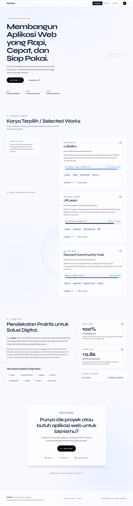

# RAIGA — 3D Interactive Developer Portfolio

Website portofolio 3D interaktif milik **Raiga (Full-Stack Web Developer)** yang dibangun menggunakan **Next.js 16 (App Router)**, **React Three Fiber**, **GSAP ScrollTrigger**, **Lenis**, dan **Tailwind CSS v4**. Mengusung pendekatan *Clean Light Mode* (`#F8FAFC`), tipografi ekspresif (*Syne*, *Plus Jakarta Sans*, *JetBrains Mono*), dan objek 3D *frosted-glass* interaktif yang mengikuti koreografi scroll.



---

## Fitur Utama

- **Interactive 3D Frosted-Glass Sculpture** (`src/components/three/HeroSculpture.tsx`)
  - Objek prosedural `TorusKnot` dengan `MeshTransmissionMaterial` yang membiaskan latar terang `#F8FAFC`.
  - Dilengkapi *inner faceted icosahedron core*, *metallic orbit ring*, dan *point rim light*.
  - Merespons gerakan kursor (*pointer parallax*) secara halus dan mengubah warna aksen cincin serta cahaya saat kartu proyek di-*hover* (`LabaKu`, `JPLearn`, `Discord Community Hub`).
- **Scroll-Driven 3D Choreography** (`src/components/PortfolioExperience.tsx` & `src/lib/scrollState.ts`)
  - Integrasi **GSAP ScrollTrigger** + **Lenis Smooth Scroll** yang memutasi objek state `scrollState` di luar siklus render React agar animasi `useFrame` tetap berjalan pada 60 FPS tanpa *re-render* yang tidak perlu.
  - Posisi, rotasi, dan skala objek 3D bertransisi mulus antar bagian: **Hero → Selected Projects → About & Tech Stack → Contact & Footer**.
- **Responsive & Mobile-Aware WebGL** (`src/components/three/SceneCanvas.tsx` & `SceneWrapper.tsx`)
  - `SceneCanvas` dimuat secara dinamis (`ssr: false`) melalui `SceneWrapper`.
  - Penempatan dan skala objek 3D menyesuaikan dimensi `viewport` agar tetap proporsional dan tidak menutupi teks utama pada layar mobile (`viewport.width < 7`).
- **Data-Driven Content Architecture** (`src/data/portfolio.ts`)
  - Seluruh konten teks, navigasi, daftar proyek, tech stack, dan tautan kontak terpusat di `PORTFOLIO_DATA` sehingga mudah diperbarui.

---

## Tech Stack

| Kategori | Teknologi |
| --- | --- |
| **Framework** | Next.js `16.4.6` (App Router), React `19.3.0` |
| **Bahasa** | TypeScript `5` |
| **3D & WebGL** | Three.js `0.187.0`, `@react-three/fiber` `^9.8.2`, `@react-three/drei` `^10.7.9` |
| **Animasi & Scroll** | GSAP `^3.15.1` (`ScrollTrigger`), Lenis `^1.3.28` |
| **Styling & Ikon** | Tailwind CSS `4.3.3`, `lucide-react` `^1.80.0` |
| **Tipografi** | `next/font/google` (`Syne`, `Plus_Jakarta_Sans`, `JetBrains_Mono`) |

---

## Struktur Direktori

```text
├── .stitch/
│   ├── designs/                  # Referensi desain HTML & screenshot preview
│   └── metadata.json
├── public/                       # Aset statis publik
├── src/
│   ├── app/
│   │   ├── favicon.ico
│   │   ├── globals.css           # Konfigurasi Tailwind CSS v4 & utilitas Lenis
│   │   ├── layout.tsx            # Root layout, metadata, dan Google Fonts
│   │   └── page.tsx              # Halaman utama portofolio
│   ├── components/
│   │   ├── PortfolioExperience.tsx # Orkestrasi Lenis & GSAP ScrollTrigger
│   │   ├── sections/
│   │   │   ├── Navbar.tsx
│   │   │   ├── HeroSection.tsx
│   │   │   ├── ProjectsSection.tsx
│   │   │   ├── AboutSection.tsx
│   │   │   └── ContactFooterSection.tsx
│   │   └── three/
│   │       ├── HeroSculpture.tsx # Objek 3D prosedural & logika animasi useFrame
│   │       ├── SceneCanvas.tsx   # Setup Canvas R3F, pencahayaan studio, & ContactShadows
│   │       └── SceneWrapper.tsx  # Dynamic import client-side (ssr: false)
│   ├── data/
│   │   └── portfolio.ts          # Data konten portofolio & daftar proyek
│   └── lib/
│       └── scrollState.ts        # Shared mutable state & warna aksen proyek
├── eslint.config.mjs
├── next.config.ts
├── package.json
└── tsconfig.json
```

---

## Cara Menjalankan Proyek

### Prasyarat
- **Node.js** versi 20 atau lebih baru
- **npm** (bawaan Node.js)

### Langkah Instalasi & Development

1. **Clone repositori:**
   ```bash
   git clone https://github.com/raiga7740/portfolio-3d.git
   cd portfolio-3d
   ```

2. **Install dependensi:**
   ```bash
   npm install
   ```

3. **Jalankan server development:**
   ```bash
   npm run dev
   ```
   Buka [http://localhost:3000](http://localhost:3000) di browser.

### Perintah Lainnya

| Perintah | Deskripsi |
| --- | --- |
| `npm run dev` | Menjalankan server development Next.js |
| `npm run build` | Membuat build produksi yang teroptimasi |
| `npm run start` | Menjalankan hasil build produksi |
| `npm run lint` | Menjalankan pemeriksaan ESLint |

---

## Panduan Kustomisasi

### 1. Mengubah Konten & Daftar Proyek
Edit `src/data/portfolio.ts` pada objek `PORTFOLIO_DATA` untuk memperbarui:
- Teks hero, bio singkat, dan daftar `techStack`
- Daftar proyek pada array `projects` (saat ini berisi *LabaKu*, *JPLearn*, dan *Discord Community Hub*) serta tautan `liveDemoUrl` / `githubUrl`
- Alamat email (`mailto:...`) dan tautan sosial media pada `contact`

Untuk menyesuaikan warna aksen 3D saat kartu proyek di-*hover*, ubah `PROJECT_ACCENT_COLORS` dan `DEFAULT_ACCENT_COLOR` di `src/lib/scrollState.ts` (gunakan `id` proyek sebagai key).

### 2. Mengganti Objek 3D Prosedural dengan Model `.glb` Custom
Di dalam `src/components/three/HeroSculpture.tsx` sudah tersedia panduan komentar untuk mengganti mesh `TorusKnot` bawaan dengan model `.glb` menggunakan `useGLTF` dari `@react-three/drei`:
1. Letakkan file model di `public/models/raiga-sculpture.glb`.
2. Import `useGLTF` dari `@react-three/drei` di `src/components/three/HeroSculpture.tsx`.
3. Muat model dengan `useGLTF("/models/raiga-sculpture.glb")`, render di dalam `<Float>`, dan tambahkan `useGLTF.preload("/models/raiga-sculpture.glb")` di luar komponen.

---

## Lisensi

Proyek ini dilisensikan di bawah **MIT License** — lihat file [LICENSE](./LICENSE) untuk detail lengkap.
